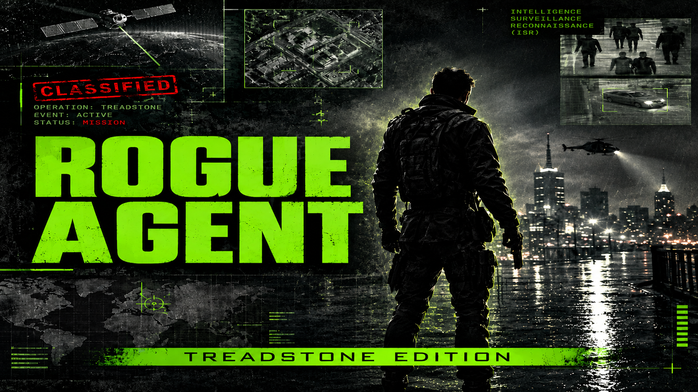
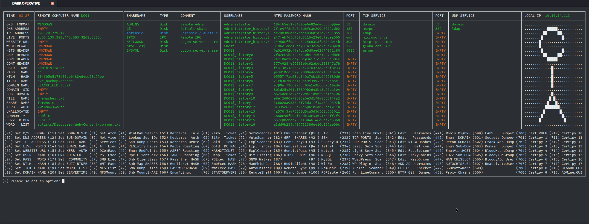
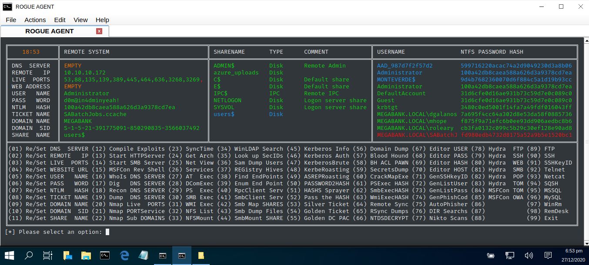

# 🛰️ ROGUE AGENT - TREADSTONE EDITION 2026

**ALPHA RELEASE | Cybersecurity Research & Network Assessment Toolkit**

<p align="center">
  
</p>

## COMMAND CENTRE FOR AUTHORISED NETWORK SECURITY ANALYSIS

ROGUE AGENT is a Python-based cybersecurity research toolkit designed to assist security professionals with assessing the exposure and security posture of computer networks and directory-service environments.

The project brings together network discovery, service enumeration, infrastructure analysis and Active Directory security-testing workflows under a portable command-line interface.

Its companion **DARK OPERATIVE** component provides an additional command-centre workflow, identified in the project as the wide-screen **LARX** edition.

The project covers network reconnaissance, SMB and LDAP analysis, identity and credential-security assessment, Kerberos security research and supporting automation.

| Project | Details |
|---|---|
| Project | ROGUE AGENT |
| Editions | TREADSTONE / LARX |
| Release | Alpha |
| Language | Python 3 |
| Interface | Command-line tools |
| Target platform | Kali Linux |
| Intended environment | Authorised security assessments and training labs |

---

## CORE CAPABILITIES & DEVELOPMENT AREAS

### 01. 🌐 Network Reconnaissance & Asset Discovery

- Discovery and enumeration of reachable network hosts.
- Identification of exposed TCP ports and network services.
- Collection of service and host information.
- Mapping of externally accessible network infrastructure.
- Identification of potential attack-surface exposure.
- Organisation of reconnaissance findings.

### 02. 🔎 Service Enumeration & Exposure Analysis

- Inspection of discovered network services.
- SMB service and share-enumeration assessment.
- LDAP service discovery and configuration review.
- Review of service exposure and access-control boundaries.
- Identification of potentially insecure or unnecessary services.
- Documentation of findings for manual validation.

### 03. 🏢 Active Directory & Identity Security

- Analysis of Active Directory environments through supported LDAP and SMB workflows.
- Review of directory information and identity-related exposure.
- Assessment of account, group and directory configuration.
- Identification of potentially excessive permissions.
- Review of authentication and authorisation boundaries.
- Documentation of identity-security observations.

### 04. 🔐 Credential & Authentication Security

- Assessment of credential-handling and authentication controls.
- Review of password and account-security exposure.
- Security research into credential-material protection.
- Controlled validation of authentication weaknesses in laboratory environments.
- Review of credential storage and access practices.
- Documentation of findings without exposing live credentials.

### 05. 🎟️ Kerberos Security Research

- Examination of Kerberos authentication concepts and configuration.
- Research into ticket-based authentication and trust relationships.
- Assessment of Kerberos-related privilege and delegation risks.
- Controlled laboratory study of ticket security and lifecycle.
- Review of defensive controls and monitoring opportunities.
- Recommendations to reduce ticket abuse and credential-theft risk.

### 06. 🧪 Controlled Security Testing

- Repeatable tests against explicitly authorised systems.
- Validation of identified weaknesses in isolated environments.
- Use of test accounts and synthetic credentials where possible.
- Separation of discovery, validation and reporting activities.
- Capture of relevant evidence and test outcomes.
- Avoidance of disruptive testing against production systems unless specifically approved.

### 07. 🖥️ Command Centre & Operator Workflows

- Python command-line entry points for the ROGUE AGENT toolkit.
- Wide-screen TREADSTONE edition.
- Shared installation and supporting utility scripts.
- Structured operator workflows for assessment activities.
- Further interface and usability development.

### 08. ⚙️ Installation & Supporting Utilities

- Automated setup through the project installation script.
- Supporting exploit and utility installation through the supplied installer workflow.
- SQLite assessment database storage via `RA.db`.
- Python-based project structure.
- Dependency installation and environment preparation.
- Compatibility validation for the selected Linux distribution.

### 09. 📊 Assessment Evidence & Reporting

- Recording of discovered hosts, ports and services.
- Documentation of SMB, LDAP and directory-service observations.
- Organisation of identity and authentication findings.
- Evidence capture to support reproducible assessment results.

---

## PROJECT OBJECTIVES

ROGUE AGENT aims to provide a practical toolkit for authorised network and directory-service security assessment by bringing together:

- **Network visibility:** Identify reachable systems, exposed services and potential attack surfaces.
- **Infrastructure assessment:** Review SMB, LDAP and related network services.
- **Identity security:** Examine Active Directory configuration, permissions and authentication boundaries.
- **Authentication research:** Understand credential and Kerberos security risks in controlled environments.
- **Repeatable testing:** Support structured, evidence-led security assessment workflows.
- **Defensive improvement:** Translate technical observations into practical remediation recommendations.
- **Portable operation:** Provide Python-based command-line entry points for supported Linux environments.

## INTENDED USE CASES

- Authorised internal and external network security assessments.
- Active Directory and identity-security reviews.
- SMB and LDAP configuration assessments.
- Cybersecurity education and controlled training laboratories.
- Capture The Flag (CTF) environments where the relevant activity is permitted.
- Kerberos and authentication-security research using test infrastructure.
- Security validation and technical reporting.

## REQUIREMENTS

- Python 3.
- Kali Linux (the original README states Kali Linux 2019 was tested).
- Git.
- Project dependencies installed through the supplied installer.
- SQLite support for the included `RA.db` component.
- An authorised test network or isolated laboratory.
  
---

## INSTALLATION & USAGE

Clone the repository:

```bash
git clone https://github.com/BroadbentT/ROGUE-AGENT.git
cd ROGUE-AGENT
```

Check the Python installation:

```bash
python3 --version
```

Run the project installer:

```bash
python3 install.py
```

Launch the ROGUE AGENT command centre:

```bash
python3 rogueAgent.py
```

The available commands, options and supported workflows depend on the current implementation. Review the source code and installer before execution.

---

## PROJECT FILES & METADATA

| Language / Type | Filename | MD5 Hash | Description | Edition |
|---|---|---|---|---|
| Python 3 | `install.py` | `1308801d23d07210c07b38af764db8a0` | Install Program | TREADSTONE |
| Python 3 | `exploits.py` | `b2de8bb948b7aa1bfe77613a06597e99` | Install Exploits | TREADSTONE |
| Python 3 | `rogueAgent.py` | `f8989e57375119f71f092cfca62385fd` | Command Centre | TREADSTONE |
| Python 3 | `shell.py` | `0ae617318d2c78a587ea2844733d1db0` | Auto Reverse Shell | LARX |
| SQLite 3 | `RA.db` | `bd47bafed06142a10a00a635de180854` | Program Database | LARX |

---

## RELEASE NOTES & DEVELOPMENT STATUS

## NEW WIDE-SCREEN TREADSTONE VERSION 2026 ##

<p align="center">
  
</p>

## ROGUE AGENT CONSOLE DISPLAY AND VIDEO LINK

[](https://youtu.be/fx6gZ2zYQ68 "RogueAgent")

---

## LEGAL & ETHICAL USE

### COMPUTER MISUSE ACT 1990 — SECTION 3A

ROGUE AGENT is intended for legitimate cybersecurity research, authorised penetration testing, defensive security validation and controlled educational environments.

Users are responsible for obtaining explicit permission before scanning, accessing, testing or otherwise interacting with any network, host, directory service or account.

Do not use this software to gain unauthorised access, steal credentials, deploy persistence, disrupt services, or conduct phishing or other deceptive activity against people or systems without explicit written authorisation and appropriate safeguards.

Testing techniques involving authentication, credentials, remote access or directory services must be restricted to systems and accounts that the operator is authorised to assess.

Unauthorised activity may breach the Computer Misuse Act 1990 and other applicable laws. The developer does not endorse unauthorised access, disruption, credential theft or misuse of this software.

---

## REFERENCES & FURTHER LEARNING

- [ROGUE-AGENT — GitHub Repository](https://github.com/BroadbentT/ROGUE-AGENT)
- [MITRE ATT&CK](https://attack.mitre.org/)
- [Microsoft — Active Directory Documentation](https://learn.microsoft.com/en-us/windows-server/identity/ad-ds/)
- [Microsoft — Kerberos Authentication Overview](https://learn.microsoft.com/en-us/windows-server/security/kerberos/kerberos-authentication-overview)
- [OWASP — Web Security Testing Guide](https://owasp.org/www-project-web-security-testing-guide/)
- [NIST — Technical Guide to Information Security Testing and Assessment](https://csrc.nist.gov/pubs/sp/800/115/final)

---

## SUPPORT THE PROJECT

Found this project useful, or would like to support further development?

[☕ Support the developer via PayPal](https://paypal.me/TerenceBroadbent)

---

**ROGUE AGENT — TREADSTONE / DARK OPERATIVE — LARX**

*Discover. Assess. Validate. Defend.*
